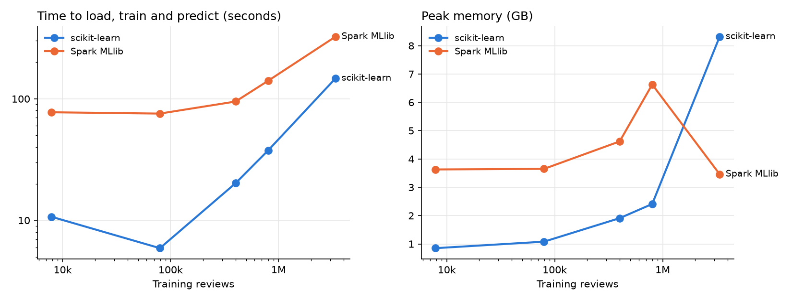

# Amazon Reviews Sentiment at Scale

A sentiment classifier for Amazon product reviews (positive or negative),
scaled from 1,000 reviews on scikit-learn to millions of reviews on Spark,
with a benchmark of the two engines on the same data.

The first version of this project trained on about 1,000 reviews with
scikit-learn. This version asks what changes when the data gets thousands of
times bigger: which engine is faster at which size, where a single machine
runs out of memory, and what the model's mistakes say about the reviews.

- Scikit-learn was faster than Spark at every size on one laptop (147 s vs 325 s on 3.4M training reviews), and macro F1 was within 0.01 (0.9005 vs 0.9075).
- Scikit-learn's memory grew with the data (0.85 GB to 8.3 GB) because it holds everything in RAM. Spark's stayed between 3.5 and 6.6 GB, probably because it works through the data in partitions.
- Logistic regression was the best of the three models (0.908 macro F1), ahead of linear SVM (0.903) and Naive Bayes (0.859), and it trained about 40% faster than the SVM.
- More data helped with diminishing returns: macro F1 went from 0.864 (7,878 training reviews) to 0.9005 (3.4M).

## Results

Data: the `Video_Games` category of [Amazon Reviews 2023](https://amazon-reviews-2023.github.io/)
(McAuley Lab, UC San Diego). Counts after cleaning are in
[results/prepare_stats.json](results/prepare_stats.json).

### scikit-learn vs Spark



| engine | training reviews | seconds | memory (GB) | macro F1 |
|---|---:|---:|---:|---:|
| sklearn | 7,878 | 10.7 | 0.85 | 0.8642 |
| spark | 7,878 | 77.5 | 3.63 | 0.8663 |
| sklearn | 79,635 | 5.9 | 1.08 | 0.8785 |
| spark | 79,635 | 75.6 | 3.65 | 0.8615 |
| sklearn | 399,741 | 20.2 | 1.91 | 0.8946 |
| spark | 399,741 | 95.0 | 4.62 | 0.8939 |
| sklearn | 800,081 | 37.6 | 2.41 | 0.898 |
| spark | 800,081 | 140.7 | 6.63 | 0.9011 |
| sklearn | 3,373,400 | 147.4 | 8.32 | 0.9005 |
| spark | 3,373,400 | 325.0 | 3.46 | 0.9075 |

Both engines use the same reviews, the same features and the same model, so
the comparison is about the engine. That needed some care: with its default
settings, Spark scored 0.75 macro F1 against scikit-learn's 0.86 on the same
36,584 training reviews (a test run on 50,000 reviews). A few of Spark's
defaults differ from scikit-learn's, and `common.py` changes them so both
engines train the same model. The one that mattered most: Spark rescales every
feature before penalizing large weights, so rare words are barely penalized
and the model overfits.

### Three models compared in Spark, full dataset

Trained on 3,373,400 reviews, tested on 842,727 reviews.

| model               |   macro_f1 |   f1_negative |   f1_positive |   accuracy |   training_seconds |
|:--------------------|-----------:|--------------:|--------------:|-----------:|-------------------:|
| Naive Bayes         |      0.859 |         0.782 |         0.935 |      0.9   |                 18 |
| Logistic regression |      0.908 |         0.855 |         0.96  |      0.938 |                178 |
| Linear SVM          |      0.903 |         0.848 |         0.958 |      0.935 |                300 |

### Where the model goes wrong

[results/error_analysis.md](results/error_analysis.md): error rate by star
rating, the words the model relies on most, its most confident mistakes, and
how much keeping "not" helps.

### What the reviews say

[results/insights.md](results/insights.md): review length and helpful votes by
star rating, verified vs unverified purchases, the most polarising products,
and ratings by year. Computed with Spark SQL over the full dataset.

## How it works

```
Video_Games.jsonl.gz
        |
  prepare_data.py     clean text, remove stop words, label, save as Parquet
        |
data/reviews.parquet
        |
        +-- run_benchmark.sh -> train_one.py    scikit-learn vs Spark at growing sizes
        +-- compare_models.py                   Naive Bayes vs logistic regression vs SVM
        +-- insights.py                         Spark SQL questions about the reviews
        +-- error_analysis.py                   where the model is wrong
```

The model: each review becomes a vector of TF-IDF scores for its words and
word pairs ("not good" counts as one term), hashed into 262,144 slots. Logistic
regression learns one weight per slot and predicts positive or negative.
Labels come from the stars: 4-5 is positive, 1-2 is negative, 3 is skipped.

Decisions worth explaining:

- **Parquet before anything else.** A `.gz` file can only be read from the
  start, so Spark reads it with one core. Parquet can be read in parallel,
  and a script loads only the columns it needs.
- **The same rows for both engines.** Every review gets two random numbers
  that are saved with the data. "Take 10%" means "rows where the number is
  below 0.1", so pandas and Spark always get exactly the same reviews and the
  same test set.
- **Hashing instead of a vocabulary.** A list of every word pair in millions of
  reviews is a huge dictionary that must fit in memory. Hashing turns each term
  into a slot number with no dictionary. The cost is that slots can't be turned
  back into words, so error_analysis.py uses a real vocabulary on a sample.
- **Macro F1 instead of accuracy.** Most reviews are positive, so a model that
  always says "positive" looks good on accuracy. Macro F1 averages the score
  of both classes, so it can't hide that. Class weights are balanced for the
  same reason.
- **Negation words are kept.** Version 1 removed "not" as a stop word, so
  "not good" became "good". Contractions like "don't" are also expanded to
  "do not" before punctuation is removed.

## Run it

Spark needs Java 17 or newer. On Windows, run everything inside WSL (Ubuntu),
because Spark on plain Windows needs extra setup to write files.

1. Give WSL more memory. By default it gets half of the computer's RAM. Create
   `C:\Users\<you>\.wslconfig` containing:
   ```ini
   [wsl2]
   memory=12GB
   ```
   then run `wsl --shutdown` in PowerShell and open Ubuntu again.
2. Install and test:
   ```bash
   sudo apt update && sudo apt install -y openjdk-17-jdk python3-venv wget
   python3 -m venv .venv
   source .venv/bin/activate
   pip install -r requirements.txt
   python -m pytest -q
   ```
3. Download the data (about 4.6 million reviews):
   ```bash
   mkdir -p data/raw
   wget -P data/raw https://mcauleylab.ucsd.edu/public_datasets/data/amazon_2023/raw/review_categories/Video_Games.jsonl.gz
   ```
4. Run the steps:
   ```bash
   python prepare_data.py data/raw/Video_Games.jsonl.gz
   bash run_benchmark.sh
   python compare_models.py
   python insights.py
   python error_analysis.py
   ```

For a quick check that everything works, first run
`python prepare_data.py data/raw/Video_Games.jsonl.gz --limit 50000` and
`bash run_benchmark.sh 10000 all`, then run the full version.

## Limitations

- Spark runs on one laptop, not a cluster. That shows how the engines behave
  as the data grows, but on a cluster the results would be different.
- Star ratings are noisy labels: some people write a happy review and give 2
  stars because of shipping. The most confident mistakes in
  error_analysis.md show how often that happens.
- Hashing into 262,144 slots means some unrelated terms share a slot.

## Files

| File | What it does |
|---|---|
| `prepare_data.py` | raw JSON to cleaned, labelled Parquet |
| `cleaning.py` | text cleaning rules and the stop word list |
| `common.py` | starting Spark, loading samples, the Spark feature steps |
| `train_one.py` | trains one engine on one sample size, saves time, memory and score |
| `run_benchmark.sh` | runs train_one.py for every size and both engines |
| `plot_benchmark.py` | makes the benchmark table and chart |
| `compare_models.py` | three models in Spark on the full data |
| `insights.py` | Spark SQL questions about the reviews |
| `error_analysis.py` | mistakes, strongest words, the negation test |
| `tests/` | tests for the cleaning rules |
